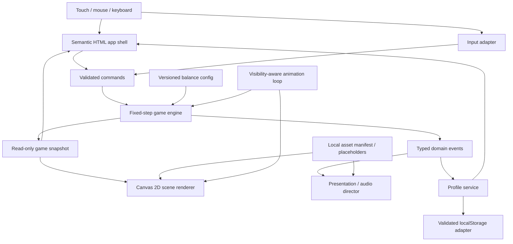

# HLD — high-level architecture

## System boundary

Nekotsumi MVP is a static browser application. All gameplay and profile processing run in the user's browser. The OpenBot VPS is the development machine; it is not automatically a production game server. A production static host is a later approval decision. No backend, login, network gameplay, runtime generative service or external API is needed.

## Layers and ownership

| Layer | Owns | Must not own |
|---|---|---|
| Domain engine | Round state, RNG, fixed ticks, x/y, contact/COM rules, grade, score, event sequence | DOM, canvas, localStorage, audio, wall-clock callbacks |
| Input adapter | Pointer/key mapping, focus isolation, generation and repeat guards | Placement decisions or score |
| App controller | Screen/modal routing, lifecycle pause, engine/service wiring, start/replay | A second physics implementation |
| Renderer | Canvas sizing, projection, culling, interpolation, transforms | Logical collisions, records, progression |
| Presentation director | Expressions, squash, camera smoothing, bounded collapse particles, sound priorities | RNG that affects simulation, gameplay timers |
| Profile service | Validated durable state, migrations, records, unlock derivation, settings, write capability | Restoring live physics or trusting raw JSON |
| Asset service | Manifest validation, loading/fallback, source metadata | Rule changes based on image dimensions |
| HTML shell | Focusable controls, HUD, dialogs, live text, settings, error feedback | Hidden global shortcuts that bypass command guards |

Only the engine emits authoritative `placementCommitted` and `roundFailed`. One event fan-out distributes them to services; no service subscribes twice after replay. Audio/visual effects have unique event IDs to suppress duplicates.

## Stack and build decisions

- TypeScript in strict mode, Vite `vanilla-ts` style application, CSS, native Canvas 2D. A UI framework is unnecessary for the small screen tree; if the repo later gains one, keep the engine independent.
- Unit checks can use Node's built-in test runner against compiled pure TypeScript modules or an already available compatible runner. Use one runner, not two overlapping stacks. Developer records the actual tool versions and commands.
- No Matter.js, WebGL dependency, component framework, CDN script, remote font or animation library is required. This is an architectural choice, not an assertion about those tools' quality.
- Use the locally available supported Node release and exact compatible tool versions in the lockfile. Do not install system runtimes or paid services without separate authorization. If compatible tools are absent, report the exact environment finding and propose the smallest remedy.
- Build output is a static `dist/` directory. Development/preview must bind loopback by default; no public tunnel or deployment from this brief.

Vite's current official guide/build documentation was consulted for version requirements and the normal build pipeline; implementation must still inspect its actual installed versions. [Vite getting started](https://vite.dev/guide/), [production build](https://vite.dev/guide/build.html).

## Simulation and scheduling

`requestAnimationFrame` drives presentation. Feed elapsed foreground time into a fixed 1/60-second accumulator. Process at most 5 ticks per frame. If foreground frame gap >250 ms, pause with reason `interrupted` and discard that gap; for smaller gaps, discard excess backlog beyond five ticks, slowing rather than leaping through input windows. Never advance from `Date.now()` in the engine.

Simulation time freezes in PAUSED. Visibility/focus events immediately pause without waiting for another animation frame. On resume clear accumulator and prior timestamp. Display interpolation is allowed for falling/camera presentation but must not extrapolate incoming horizontal x: render the same current-tick aim position that a drop command will capture. At the start of each tick drain FIFO commands, validate them against state/run/spawn generation, then advance simulation, resolve transitions and publish events. A command before a frame samples the last published logical position; no retroactive wall-clock alignment or latency compensation.

Browser animation frames can be paused/throttled in hidden pages, so lifecycle behavior is explicit rather than based on frame arrival. [Animation-frame API](https://developer.mozilla.org/en-US/docs/Web/API/Window/requestAnimationFrame), [Page Visibility API](https://developer.mozilla.org/en-US/docs/Web/API/Page_Visibility_API).

## Viewport and camera

The HTML shell reserves real space for HUD and controls. Canvas fills the remaining playfield with 10 logical world units across. Its CSS box is independent of backing pixel dimensions; backing scale=min(devicePixelRatio,2), with a pixel-area cap of 2 million. Respect safe-area insets and dynamic viewport height. Resizing changes projection, never physics.

Camera is vertical only. Let playfield world-height V=cssHeight/(cssWidth/10). Keep supportTop at about 40% of V from bottom and incoming bottom+H within the upper safe region. `cameraBottom=max(-0.8,supportTop-0.40×V)` for normal portrait fields. Require V>=10: when the available box is shorter, center a game panel of width=min(availableWidth,availableHeight) and full availableHeight, so the 10-unit world width still fits without shortening the drop. Smooth movement over 0.25 seconds; reduced motion uses immediate reposition between placements. Incoming spawn uses logical supportTop whether camera has finished moving. Input does not depend on camera.

Render floor if visible, then visible settled cats, contact warning, incoming, bounded effects. UI text stays DOM-based. Cull cats outside camera bounds plus one cat height; no hidden DOM element per cat. Preserve the entire lightweight logical tower for balance checks. After >=1,000 cats, implement origin-relative rendering if needed; profile measurements, not visual history truncation, determine optimization.

## Save and concurrency boundary

Profile is a small, versioned JSON document in localStorage. Read/write exceptions are handled. At startup acquire a same-origin exclusive Web Lock named `cat-tower.profile.v1` for the lifetime of this page. Only its owner may persist. Another open tab can read, retry ownership after the first tab closes, or choose an explicitly labeled temporary session. No lock stealing; no race-prone localStorage lease fallback.

If Web Locks are absent, use temporary-session mode with a clear “Progress cannot be saved in this browser session” notice. This is a deliberate degraded path to avoid corrupting shared totals. Reading an existing supported profile is still allowed. Game logic must not depend on persistence. A future server sync design must specify conflicts separately.

Web Locks coordinate same-origin resource access; localStorage may throw or be unavailable, so neither is assumed infallible. [Web Locks API](https://developer.mozilla.org/en-US/docs/Web/API/Web_Locks_API), [localStorage](https://developer.mozilla.org/en-US/docs/Web/API/Window/localStorage).

## Audio and assets

Create/resume Web Audio only from a trusted user interaction. Audio failure leaves gameplay fully usable. One master gain, <=6 short voices, priority throttling, no spoken content in MVP, no automatic music. Muting stops voices immediately. Hide/pause suspends audio. Optional asset decode is asynchronous and never blocks release/collision logic. [Web Audio best practices](https://developer.mozilla.org/en-US/docs/Web/API/Web_Audio_API/Best_practices).

Default placeholder cats render as local geometric paths with face features; they require no network and retain exact logical bounds. If approved assets fail, draw placeholders and continue. Cosmetic availability is a profile rule, independent of whether a particular PNG has loaded. Studio supplies provenance and approval status; unapproved files cannot become default release art accidentally.

## Failure and privacy behavior

- Profile parse/migration failure: retain original stored string, open temporary profile, show warning; never silently overwrite unreadable/future data.
- Individual optional asset/audio failure: fallback and a bounded developer diagnostic, no blocking modal.
- No canvas/context: accessible HTML unsupported message. No silent blank screen.
- Unexpected simulation error: stop loop, pause services, retain last durable checkpoint, surface Retry/Home if safe; do not continue awarding points.
- No cookies, tracking IDs, user text uploads, external fonts or analytics. Random run IDs are local idempotency tokens, not transmitted identifiers.
- Local saves are editable and records are not cheat-proof. Do not market them as secure competition.

## Performance and operability targets

At 390×844 and DPR<=2, target 60 fps; simulation step p95 <2 ms at 1,000-cat fixture; frame p95 <=20 ms and p99 <=33 ms on a named representative phone. Render <=24 settled cats, <=20 collapse bodies and <=40 transient particles. Reduce particles first if frame budget is exceeded; never change scoring/physics or silently change Classic speed. Capture actual evidence before claiming the targets pass.

Log build version, balanceVersion and bounded error categories in local debug mode. Do not log personal data or pollute normal play with per-frame messages. A debug panel may display seed, tick, weakest joint, current offset, safety and state; it is disabled in normal UI. Test commands can inject deterministic seed/actions through engine APIs rather than browser-global mutation endpoints.

## Later extensions

Mobile packaging can reuse the same static app and pure engine. A future backend would sit behind a separate profile/leaderboard port, with authentication, privacy and abuse handling designed then. A future physics engine requires an Architect rules revision and rebaselined records. Neither is a dependency of MVP.
